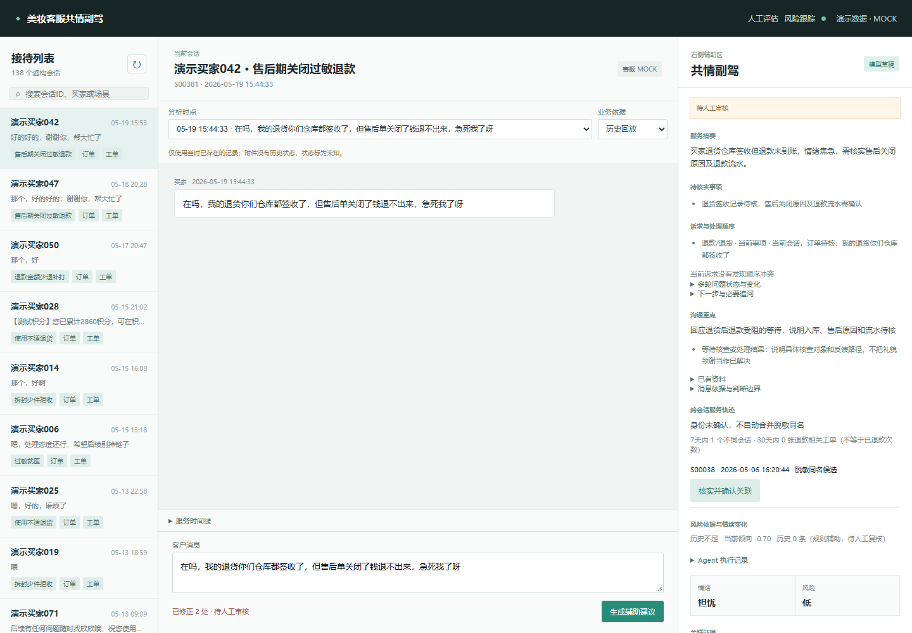
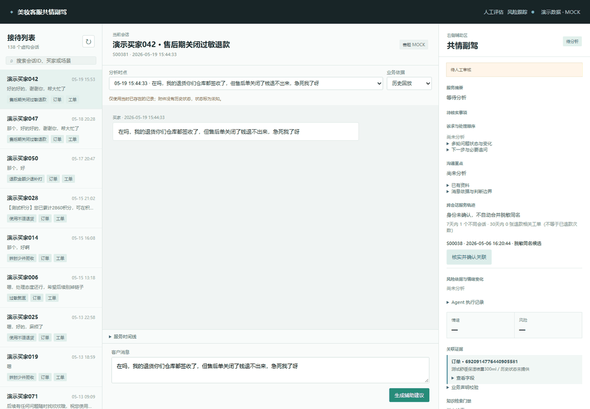
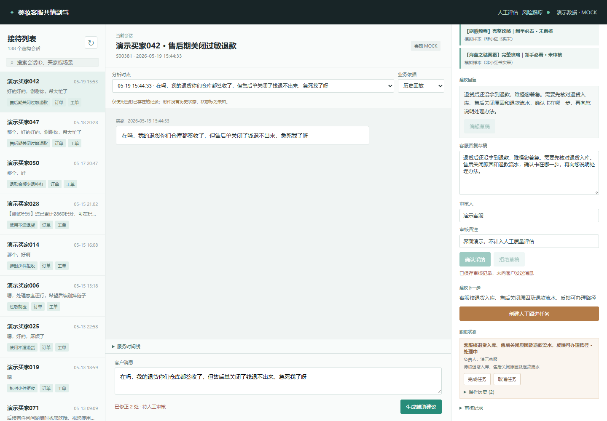
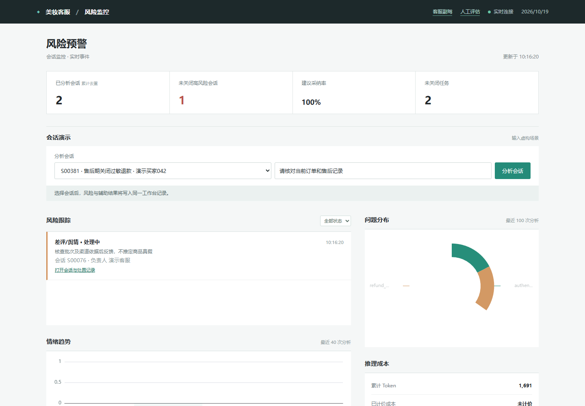
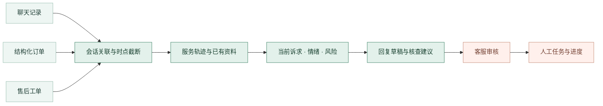
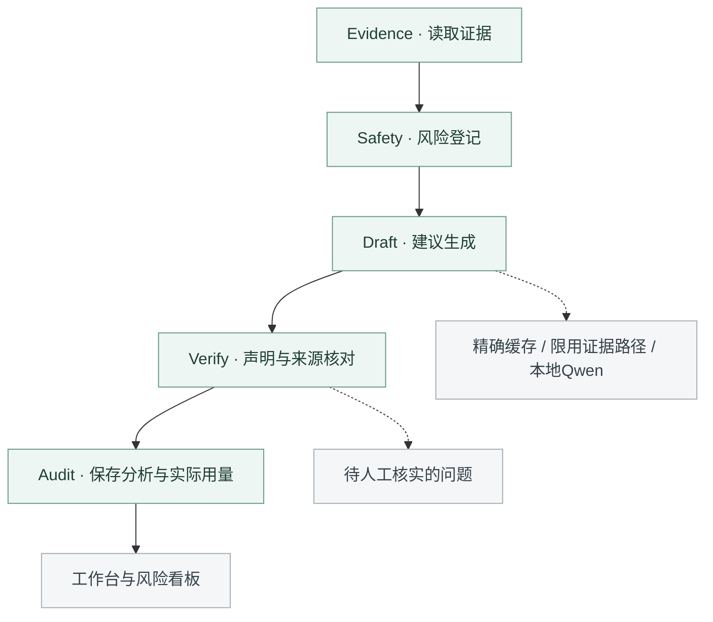
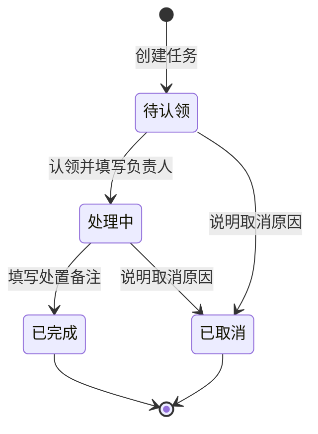

<div align="center">

# 美妆客服共情副驾

**聊天、订单与售后工单，一起看；客户的着急和顾虑，一起处理。**

面向美妆电商人工客服的本地工作台

`V10` · `Qwen3:8b` · `LangGraph` · `Python 3.11` · `本地运行`

[界面与演示](#demo) · [快速开始](#quickstart) · [工作流程](#workflow) · [评估结果](#evaluation) · [技术文档](#docs)

</div>



<p align="center"><sub>实际Demo截图 · 赛题虚构业务数据 · 本地Qwen生成 · 回复由客服审核</sub></p>

## 这套工作台做什么

消费者已经说过的订单、肤质顾虑和等待事项，不应每次进线都重新解释。客服也需要知道：眼前这句话在问什么，之前处理到哪一步，接下来该由谁核查。

共情副驾把这些信息放进同一条接待流程，从服务记录中找依据，给出可编辑的回复，再把待办交给负责人。

| 接待中的问题 | 工作台里的处理 |
| --- | --- |
| 聊天、订单和工单分散 | 关联展示服务记录，按选定时点回放 |
| 客户反复解释，问题仍未解决 | 记录已有资料与未解决事项，减少重复追问 |
| 回复只有处理步骤，没有回应顾虑 | 根据具体等待、担心和诉求起草共情回复 |
| 识别到投诉风险，但无人继续跟进 | 登记风险任务，认领、备注并更新处理状态 |

<a id="demo"></a>

## 界面与演示

### 接待到跟进



<sub>实际界面状态的动态预览，已调整停留时间，不代表模型实时响应速度。</sub>

**完整操作录像：** [播放或下载MP4](docs/media/demo.mp4) · [本地HTML播放器](docs/demo.html)

录像时长约3分28秒。下载项目后，直接打开 `docs/demo.html` 可在浏览器播放；GitHub中可先看上方GIF或打开MP4文件。

### 回复审核

草稿旁保留业务依据、待核事项和下一步。客服修改后采纳或拒绝，审核记录与跟进任务分别保存。



### 风险看板

从风险任务进入原会话，查看依据、负责人和处理进度。任务状态变化留有记录，不把“完成跟进”当作“已退款到账”。



<a id="quickstart"></a>

## 快速开始

准备 **Python 3.11** 和 **Ollama**，在项目根目录打开PowerShell：

```powershell
py -3.11 -m venv .venv
.\.venv\Scripts\python.exe -m pip install -r requirements_runtime.txt
Copy-Item .env.example .env
ollama pull qwen3:8b
.\.venv\Scripts\python.exe scripts\check_local_model.py
.\.venv\Scripts\python.exe scripts\run_demo.py --port 5000
```

已有 `.env` 时跳过复制。确保Ollama已启动，按终端显示的地址打开工作台。也可以在准备完成后双击 `start_demo.cmd`，由启动器选择可用端口。

| 页面 | 路径 |
| --- | --- |
| 客服工作台 | `/workbench` |
| 风险跟踪看板 | `/dashboard` |
| 标注与效率对照 | `/evaluation` |

默认使用本机 `qwen3:8b`，不需要云端密钥。依赖与模型首次下载完成后可断网运行，无需Node、Docker或单独部署Redis、Qdrant。模型权重不在源码包内。

完整安装、停止服务和现场演示步骤见 **[运行指南](运行指南.md)**。

<a id="workflow"></a>

## 工作流程

### 多源数据，回到同一个问题



历史回放排除选定消息之后的记录。昵称相似只提供关联候选，人工确认身份后才合并跨会话轨迹；缺失的历史状态保留为未知。

### 五阶段Agent工作流



风险登记在模型排队前完成。模型超时或不可用时保留任务，并明确显示降级状态。编排实现位于 `src/orchestration/workbench_workflow.py`。

### 人工跟进



系统只保存建议、审核和本地任务，不自动发送客户消息，不执行退款、补发或改址。

## 性能与成本

| 机制 | 当前做法 |
| --- | --- |
| 紧凑输出 | 结构化短字段，单次输出上限360 Token |
| 精确缓存 | 按提示版本、提供方和模型配置隔离，命中后仍检查当前风险 |
| 证据路径 | 仅明确问候、符合条件的单订单既往发货查询可跳过生成 |
| 有界队列 | 默认1个worker、容量3，风险登记不等待生成 |
| 单次生成复用 | 模糊意图在已有生成中补判，不追加独立分类调用 |

<a id="evaluation"></a>

## 评估结果

| 检查范围 | 结果 |
| --- | --- |
| 独立运行环境软件测试 | 382项通过，3项可选研究检查跳过 |
| 固定12例回复回归 | 11次本地模型生成，1次证据路径，零不可用降级 |
| 12例Token总量 | 8358，与V9的8356基本持平 |
| 原开发环境12例耗时 | 系统中位约2.77秒，样本最大4.80秒 |

<details>
<summary><strong>查看样本范围与人工复核口径</strong></summary>

原30条已见样本回归：最终意图28/30、基础情绪20/30、风险27/30；V9对应为27/30、21/30、27/30。意图多匹配1条，情绪少匹配1条，不能称为独立盲测准确率或全面提升。

单人复核12条V9回复：8条原可见草稿可用、4条修改后认可。结论对应当时保存的文本，不自动算作V10人工通过。原效率对照缺完整任务级计时，没有报告真人提效比例。

软件测试与模型测量分开。时延来自原设备上的固定小样本，不作为生产并发或其他设备的性能保证。详细方法见 [评估说明](docs/EVALUATION.md)。

</details>

<a id="docs"></a>

## 技术文档

| 想了解什么 | 文档 |
| --- | --- |
| 安装、启动和现场操作 | [运行指南](运行指南.md) |
| 节点、状态与人工决策 | [Agent设计](docs/AGENT_DESIGN.md) |
| 数据、API和存储 | [技术架构](docs/ARCHITECTURE.md) |
| 测试与模型评测方法 | [评估说明](docs/EVALUATION.md) |
| 数据范围及使用权限 | [数据说明](docs/DATA_POLICY.md) |
| 当前能力与部署条件 | [使用限制](docs/KNOWN_LIMITATIONS.md) |
| 组件及前端库许可 | [第三方组件说明](THIRD_PARTY_NOTICES.md) |

<details>
<summary>项目目录</summary>

```text
src/                    Agent、工作流、数据处理和API
frontend/               实际工作台页面与静态资源
data/                   虚构业务数据和演示知识
evaluation/             评测脚本、协议和标注模板
tests/                  自动化测试
scripts/                启动和模型检查工具
docs/                   技术文档、截图与视频页
运行指南.md             完整运行步骤
```

</details>

<sub>当前为本机演示原型，未接入生产售后系统。赛题数据的公开再分发权限需另行确认；源码尚未指定开源许可证。第三方组件及模型权重按各自许可使用。</sub>
